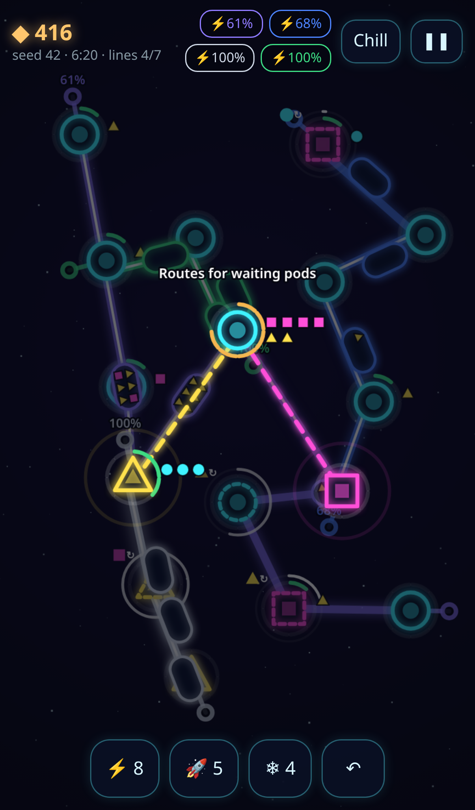

# Neon Orbit (prototype v2)

A quiet, neon, space-themed transit builder. Draw glowing conduits between geometric stations; little capsule ships carry each cargo pod to a station of the **same colored shape**: cyan ● circle, magenta ■ square, yellow ▲ triangle, orange ◆ diamond. Lines use a separate, cooler palette (violet, blue, silver, green, bronze…) so they never look like a shape. Let one station get too crowded for too long and the run ends.

**Play:** https://rc-jwheeler.github.io/neon-orbit/  ·  pick a map with `?seed=123` (e.g. https://rc-jwheeler.github.io/neon-orbit/?seed=42)

Single file (`index.html`), Canvas 2D, no build step, no backend.

## Controls (touch or mouse)

| Action | How |
|---|---|
| New line | Drag from a station across other stations, release. 5 lines to start, +1 every 40 deliveries (up to 7). |
| Extend a line | Drag the small round **knob** at either end of a line onto more stations. Drag back over a station to un-add it. |
| Delete / redraw | **Long-press** a line (or tap its ⚡% chip at the top), then **✕ Delete line**. Redraws are free. |
| See where pods will go | **Tap a station** (or hover with a mouse). Everything dims and each waiting pod's route is drawn as an animated dashed path, in the pod's color, to its destination. Tap empty space or a line to clear. |
| Add a ship | Earn a 🚀 token every 20 deliveries (max 5 held). Tap **🚀**, then tap a line. Up to 3 ships per line; deleting a line refunds its extra ships. |
| Boost a conduit | **Tap a line** (or ⚡ then tap a line). Uses one charge: +50% energy. |
| Stabilize a phase station | Tap **❄**, then tap a dashed (phase) station: its shape is frozen for 10 s. |
| Undo last line edit | **↶** button or **Ctrl/Cmd+Z** |
| Pause / speed | **❚❚** (or Space) · speed button cycles **Chill (0.5×) / 1× / 2× / 3×**. Chill is the default; your choice is remembered. |

The simulation always pauses while you are drawing or have a line selected (dashed amber frame + "EDITING · PAUSED"). A short first-run hint (3 lines) appears once; "Got it" dismisses it for good (stored in localStorage).

## Rules

- **Stations** appear on a seeded map (circle, triangle, square; diamond later): every 30 s at first, ramping gently (1 s faster per minute) to every 18 s, up to 22 stations. Each is drawn in its shape's color.
- **Crowding:** a segmented ring around every station fills with its waiting pods against capacity 8, green → amber (over 60%) → red (over capacity). Over capacity, a pulsing red countdown ring empties over 25 s and a red arrow with the seconds left points at it from the edge of the play area; when it runs out the run ends (it recovers when the crowd clears).
- **Pods** are drawn as their destination shape, filled in that shape's color. They route over the whole network (Dijkstra over stations × lines; ride 1 per stop, board 0.5, alight 1.5, so a transfer costs 2). A pod **boards any ship whose remaining stops include a station strictly closer (by that cost) to a matching shape**, rides to the best of those stops and gets off there. Because every alight point is strictly closer than where the pod boarded, pods can't ping-pong. Routes are recomputed instantly on any edit, phase change or new station. Pods with no route turn gray and pulse, and their station gets a gray **?** badge.
- **Ships** space themselves out: a ship won't leave a stop in the same direction until a sibling on the same line has had a head start (half the even spacing, max 6 s hold).
- **Energy conduits:** every line shows its energy as glow brightness, a bright core that fills the line in proportion to energy, and a % on its start knob and HUD chip. Energy drains while its ship moves (more on longer lines) and a little per pod moved, and slowly recharges (+0.3%/s) whenever the ship carries 2 pods or fewer. Below 50% the ship slows (down to 30% speed) and the line shows red dashes. Boost charges: start with 4, +1 every 4 deliveries and every 30 s (max 8).
- **Phase stations** have a **dashed outline**, a white ring timer, and a small filled icon of the shape (and color) they'll become next. They flip between the two shapes when the timer runs out. Pods heading there flash red in the last 3 s; on the flip, pods re-path immediately (and pods already waiting there that now match are delivered). Stabilizers: start with 2, +1 every 12 deliveries (max 4).
- Score = pods delivered.

## Notes

- **Deterministic:** seeded PRNG (mulberry32) and a fixed 60 Hz timestep with an accumulator. The same seed + same edits at the same sim tick give the same run. Station layout is generated in unit space, so topology and timing match across screens; absolute positions stretch to the screen's aspect.
- `window.__dbg` exposes a small test hook (`ff(seconds)`, `step(n)`, `addLine([ids])`, `addShip(lineId)`, `route(stationId, shape)`, `platCost(stationId, shape)`, screen coordinates of stations/knobs).
- Balance is still a guess, tuned once from the first playtest (v1.1 pacing pass):

  | | v1 | v1.1 |
  |---|---|---|
  | Station spawn | every 15 s | 30 s → 18 s (−1 s/min) |
  | Pod spawn per station | 6–12 s × max(.45, 1 − t/400) | 10–18 s × max(.55, 1 − t/900) |
  | Energy drain (moving) | .003 + .006·len/500 per s | .0015 + .003·len/500 per s |
  | Drain per pod moved | .004 | .002 |
  | Passive regen | none | +.003/s when ship carries ≤ 2 pods |
  | Boosts | start 3, +1 / 6 deliveries, +1 / 45 s, max 6 | start 4, +1 / 4 deliveries, +1 / 30 s, max 8 |
  | Station capacity / overcrowd timer | 6 / 14 s | 8 / 25 s |
  | Ship speed | 78 | 72 |
  | Lines | 5 | 5, +1 per 40 deliveries, max 7 |
  | Default speed | 1× | Chill (0.5×) |

  v2 (clarity pass) changes: pod spawns no longer plateau (10–18 s per station × 1/(1 + t/300)), max stations 18 → 22, 🚀 ship token every 20 deliveries. This is to offset the smarter boarding and extra ships.

  A scripted test player (greedy extend-nearest network, boosts lines under 35%) on 10 seeds lasted a median of ~137 s of sim time in v1, ~311 s in v1.1 and ~470 s (about 7.8 min; range 335–1091 s) in v2, where it also spends ship tokens on the busiest line. At Chill speed, 470 s of sim time takes about 15.7 min of real time.
- Still out of scope on purpose: orbits, wormholes, carriages, loop lines, scoring meta.
